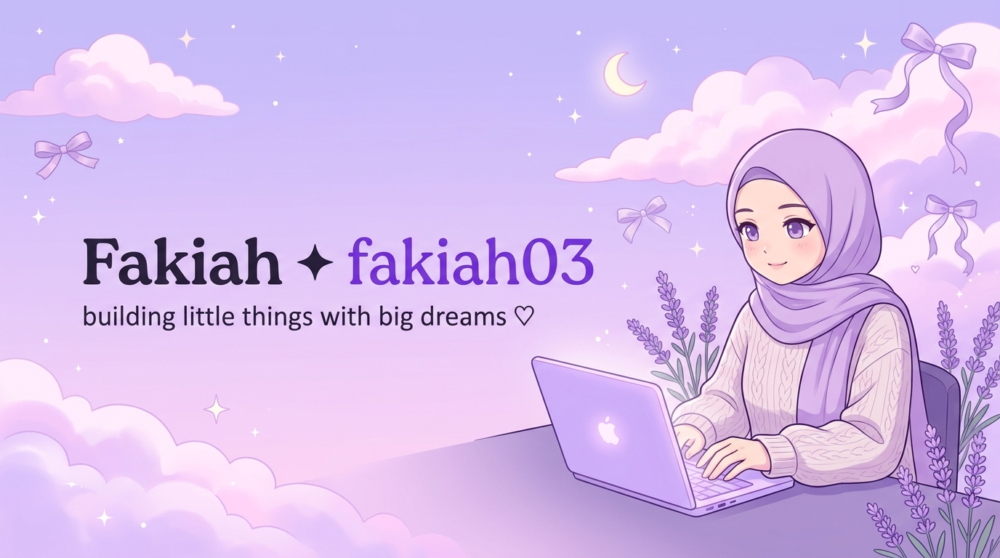
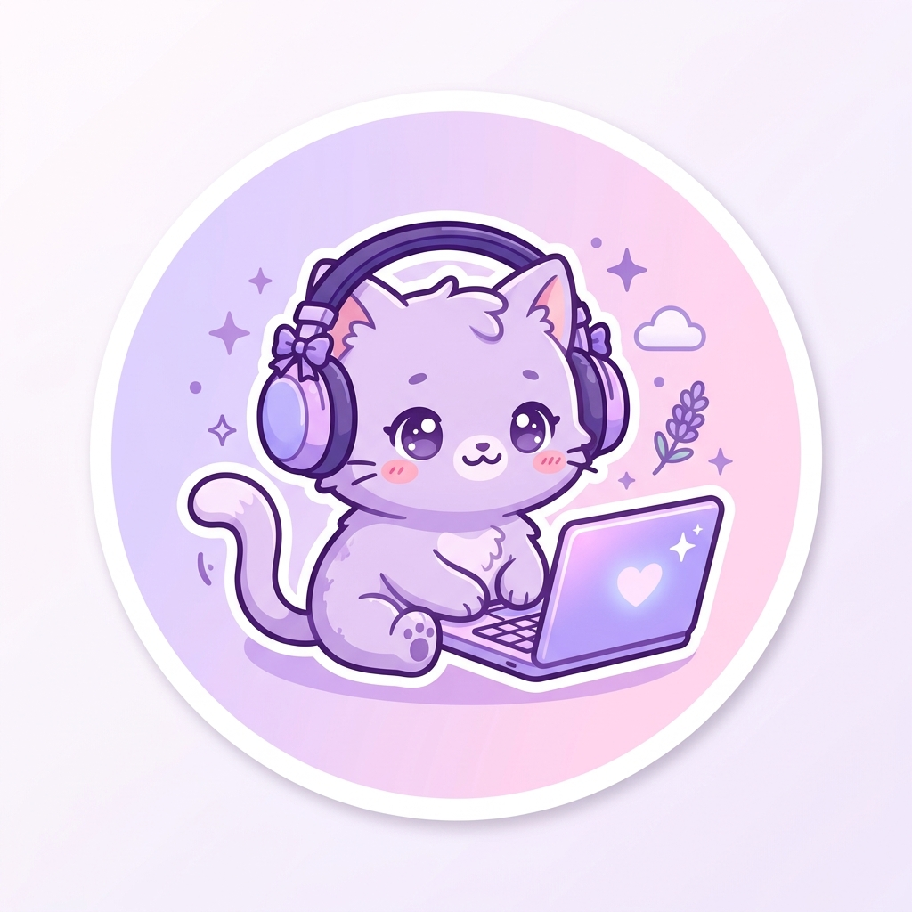
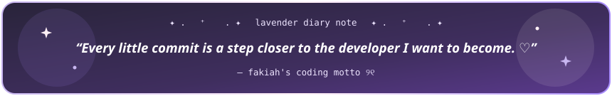

  <!-- ₊˚⊹♡ CUSTOM LAVENDER HEADER BANNER ♡⊹˚₊ -->
  <!-- Note: You can use either ./assets/lavender-header-banner.jpg (Illustrated Anime/Lo-Fi Banner)
       or ./assets/banner-animated.svg (Animated Vector SVG Banner) -->
  

    

  ✦ . 　⁺ 　 . ✦ 　₊˚⊹♡  Welcome to my coding space  ♡⊹˚₊　 ✦ . 　⁺ 　 . ✦

  <!-- ₊˚⊹♡ ANIMATED TYPING INTRODUCTION ♡⊹˚₊ -->
  

    
  

  <!-- ₊˚⊹♡ QUICK NAVIGATION & SOCIAL PILLS ♡⊹˚₊ -->
  

    
    
    
    
  

  

<!-- ══════════════════════════════════════════════════════════════════════════ -->
<!--                           🌷 5. ABOUT ME SECTION                          -->
<!-- ══════════════════════════════════════════════════════════════════════════ -->

  <h2>₊˚⊹♡ 🌷 About Me ♡⊹˚₊</h2>
  ୨୧ ────── ୨୧ ────── ୨୧

 

<table>
  <tr>
    <td width="28%" align="center" valign="middle">
      
        
      <b>✦ Fakiah's Coding Buddy ✦</b>
       
      <i>“fueled by curiosity &amp; cozy playlists ♡”</i>
    </td>
    <td width="72%" valign="middle">
      <h3>Hi there, I'm Siti Norufakiah (Fakiah)! 👋🏻💜</h3>
      

        I'm a <b>Computer Science Diploma student at UiTM Machang</b> and an aspiring software developer who loves turning thoughtful ideas into clean, helpful digital systems.
      

      <ul>
        <li>🌷 <b>Why I Love Coding:</b> I enjoy the process of solving real everyday problems—whether it's building an organized web platform, structuring a relational database, or automating repetitive tasks.</li>
        <li>☁️ <b>My Learning Journey:</b> Step by step, I am strengthening my foundation in full-stack web development (<b>PHP, JavaScript, HTML/CSS</b>), database management (<b>MySQL</b>), and data/workflow automation (<b>Python</b>).</li>
        <li>🗄️ <b>Hands-On Curiosity:</b> From classroom systems to my internship experience assisting with data migration, CRM workflows, and booking websites, I treat every project as a chance to learn something new.</li>
        <li>✨ <b>Career Aspiration:</b> My goal is to grow into a reliable, well-rounded <b>Software Developer</b> who builds user-friendly applications that make people's work and lives easier.</li>
      </ul>
    </td>
  </tr>
</table>

 

<!-- ══════════════════════════════════════════════════════════════════════════ -->
<!--                     💜 6. DEVELOPER INFORMATION CARDS                     -->
<!-- ══════════════════════════════════════════════════════════════════════════ -->

  <h3>✦ . 　⁺ 　 . ✦ 　Developer Snapshot　 ✦ . 　⁺ 　 . ✦</h3>

  

    
    
    
  

  

    
    
    
  

  

<!-- ══════════════════════════════════════════════════════════════════════════ -->
<!--                           🛠️ 7. TECH STACK                                -->
<!-- ══════════════════════════════════════════════════════════════════════════ -->

  <h2>₊˚⊹♡ 🧸 My Tech Stack &amp; Tools ♡⊹˚₊</h2>
  ୨୧ Technologies &amp; tools I use to build my projects ୨୧
    

  <!-- Skill Icons Bar -->
  

    
  

   

  <table>
    <tr>
      <th align="center">💜 Category</th>
      <th align="center">🌷 Technologies &amp; Environment</th>
    </tr>
    <tr>
      <td align="center"><b>Programming Languages</b></td>
      <td align="center">
        
        
        
      </td>
    </tr>
    <tr>
      <td align="center"><b>Frontend</b></td>
      <td align="center">
        
        
        
      </td>
    </tr>
    <tr>
      <td align="center"><b>Backend</b></td>
      <td align="center">
        
      </td>
    </tr>
    <tr>
      <td align="center"><b>Database</b></td>
      <td align="center">
        
      </td>
    </tr>
    <tr>
      <td align="center"><b>Tools &amp; Environment</b></td>
      <td align="center">
        
        
        
        
        
      </td>
    </tr>
  </table>

 

<!-- ══════════════════════════════════════════════════════════════════════════ -->
<!--                     🌱 8. CURRENTLY LEARNING SECTION                      -->
<!-- ══════════════════════════════════════════════════════════════════════════ -->

  <h2>₊˚⊹♡ 🌱 Currently Exploring ♡⊹˚₊</h2>
  ୨୧ Little topics in my study notebook right now ୨୧
    

  <table>
    <tr>
      <td width="25%" align="center">
        <b>🌷 Full-Stack Web Dev</b> 
        Building responsive interfaces &amp; clean server logic
      </td>
      <td width="25%" align="center">
        <b>🐘 PHP &amp; MySQL</b> 
        CRUD workflows, authentication &amp; relational queries
      </td>
      <td width="25%" align="center">
        <b>✨ JavaScript</b> 
        DOM interactivity, Fetch API &amp; dynamic UI states
      </td>
      <td width="25%" align="center">
        <b>🐍 Python Automation</b> 
        Data cleaning, ETL scripts &amp; spreadsheet migration
      </td>
    </tr>
    <tr>
      <td width="25%" align="center">
        <b>🗄️ Database Design</b> 
        Schema normalization, indexing &amp; clean data modeling
      </td>
      <td width="25%" align="center">
        <b>🧪 Software Testing</b> 
        Debugging, edge-case checks &amp; functional verification
      </td>
      <td width="25%" align="center">
        <b>🔗 API Integration</b> 
        Connecting REST endpoints &amp; local payment gateways
      </td>
      <td width="25%" align="center">
        <b>⚙️ System Development</b> 
        Translating real operational needs into working web apps
      </td>
    </tr>
  </table>

  

<!-- ══════════════════════════════════════════════════════════════════════════ -->
<!--                        📂 9. FEATURED PROJECTS                            -->
<!-- ══════════════════════════════════════════════════════════════════════════ -->

  <h2>₊˚⊹♡ 📂 Featured Projects ♡⊹˚₊</h2>
  ୨୧ Little digital creations crafted with care ୨୧

 

<table>
  <tr>
    <!-- Project 1: Online Bookstore System -->
    <td width="50%" valign="top">
      <h3 align="center">📚 Online Bookstore System</h3>
      

        
        
      

      

        A web application for managing books, customers, orders and bookstore operations—featuring a catalog browser, shopping cart workflow, and management dashboard.
      

      

        <b>✨ Tech Stack:</b> 
        <code>PHP</code> <code>MySQL</code> <code>JavaScript</code> <code>HTML5</code> <code>CSS3</code>
      

      

        
      

    </td>
    <!-- Project 2: Masmed Hub Parcel Management System -->
    <td width="50%" valign="top">
      <h3 align="center">📦 Masmed Hub Parcel Management System</h3>
      

        
        
      

      

        A parcel management system designed to improve parcel tracking, record management and collection processes for campus parcel operations, reducing manual logbooks.
      

      

        <b>✨ Tech Stack:</b> 
        <code>PHP</code> <code>MySQL</code> <code>JavaScript</code> <code>HTML5</code> <code>CSS3</code>
      

      

        
      

    </td>
  </tr>
  <tr>
    <!-- Project 3: Customer Management / CRM System -->
    <td width="50%" valign="top">
      <h3 align="center">🗂️ Customer Management / CRM System</h3>
      

        
        
      

      

        A customer management system focusing on customer records, database organization, membership tracking and automated follow-up workflows built to support team operations.
      

      

        <b>✨ Tech Stack:</b> 
        <code>PHP</code> <code>Python</code> <code>MySQL</code> <code>HTML5</code> <code>CSS3</code>
      

      

        <!-- Replace [YOUR_CRM_REPO_URL] with your public repo URL if published -->
        
      

    </td>
    <!-- Project 4: Homestay Booking System -->
    <td width="50%" valign="top">
      <h3 align="center">🏡 Homestay Booking System</h3>
      

        
        
      

      

        A booking platform featuring accommodation details, reservation management, interactive date selection and online checkout booking workflows.
      

      

        <b>✨ Tech Stack:</b> 
        <code>PHP</code> <code>MySQL</code> <code>JavaScript</code> <code>HTML5</code> <code>CSS3</code>
      

      

        <!-- Replace [YOUR_HOMESTAY_REPO_URL] with your public repo URL if published -->
        
      

    </td>
  </tr>
</table>

  
    ✨ <b>More little experiments on my GitHub:</b>
    <a href="https://github.com/fakiah03/english-flashcard">English Flashcard Website</a> •
    <a href="https://github.com/fakiah03/todo-app">TaskMaster To-Do App</a>
  

    
  

<!-- ══════════════════════════════════════════════════════════════════════════ -->
<!--                  📊 10. GITHUB STATISTICS & 11. ACTIVITY                  -->
<!-- ══════════════════════════════════════════════════════════════════════════ -->

  <h2>₊˚⊹♡ 📊 GitHub Diary &amp; Statistics ♡⊹˚₊</h2>
  ୨୧ Tracking my commits, languages &amp; coding consistency ୨୧
    

  <!-- GitHub Stats & Top Languages Cards (Coordinated Lavender Palette) -->
  

    
    
  

  <!-- GitHub Streak Card -->
  

    
  

  <!-- Lavender Contribution Activity Graph -->
  

    
  

  <!-- Contribution Snake Animation (Requires GitHub Actions Workflow in .github/workflows/snake.yml) -->
  <h3>🐍 Lavender Contribution Snake</h3>
  

    <picture>
      <source media="(prefers-color-scheme: dark)" srcset="https://raw.githubusercontent.com/fakiah03/fakiah03/output/github-contribution-grid-snake-dark.svg" />
      <source media="(prefers-color-scheme: light)" srcset="https://raw.githubusercontent.com/fakiah03/fakiah03/output/github-contribution-grid-snake.svg" />
      
    </picture>
  

  
    <i>💡 Note: The contribution snake above is generated automatically by the included <code>.github/workflows/snake.yml</code> GitHub Action once pushed to your <code>fakiah03/fakiah03</code> repository.</i>
  

    
  

<!-- ══════════════════════════════════════════════════════════════════════════ -->
<!--                ✨ 12. ACHIEVEMENTS & HIGHLIGHTS (DIARY LOG)               -->
<!-- ══════════════════════════════════════════════════════════════════════════ -->

  <h2>₊˚⊹♡ 📔 My Coding Journey &amp; Milestones ♡⊹˚₊</h2>
  ୨୧ Little chapters from my development notebook ୨୧

 

<table>
  <tr>
    <td width="50%" valign="top">
      <h4>🌷 Milestones &amp; What I've Built</h4>
      <ul>
        <li>✅ Started my <b>Diploma in Computer Science</b> journey at UiTM Machang and discovered a love for software building.</li>
        <li>✅ Designed &amp; built full CRUD web applications using <b>PHP, MySQL, HTML5, CSS3 &amp; JavaScript</b>.</li>
        <li>✅ Created practical student &amp; e-commerce systems including a <b>Campus Parcel Management Hub</b> and an <b>Online Bookstore</b>.</li>
        <li>✅ Built interactive browser tools like an <b>English Flashcard App</b> and a <b>To-Do Manager</b>.</li>
      </ul>
    </td>
    <td width="50%" valign="top">
      <h4>☁️ Real-World Exploration (Internship Chapter)</h4>
      <ul>
        <li>✨ Assisted with <b>Excel-to-MySQL database migration</b> using Python scripts and local database environments (Laragon).</li>
        <li>✨ Explored <b>CRM system development</b> and customer follow-up workflow logic.</li>
        <li>✨ Practiced integrating local payment gateway workflows and booking interfaces for a <b>Homestay Booking System</b>.</li>
        <li>🌱 Continuing to practice clean code, database design, and modern web development every day!</li>
      </ul>
    </td>
  </tr>
</table>

 

<!-- ══════════════════════════════════════════════════════════════════════════ -->
<!--                         💭 13. DEVELOPER QUOTE                            -->
<!-- ══════════════════════════════════════════════════════════════════════════ -->

  

 

<!-- ══════════════════════════════════════════════════════════════════════════ -->
<!--                    ⏱️ 14. CODING ACTIVITY (OPTIONAL)                      -->
<!-- ══════════════════════════════════════════════════════════════════════════ -->

  
<b>₊˚⊹♡ ⏱️ Click to view Optional WakaTime / Coding Activity Setup Notes ♡⊹˚₊</b>

   
  <blockquote>
    

      <b>How to enable live WakaTime coding activity cards (Optional):</b> 
      1. Create a free account at <a href="https://wakatime.com">wakatime.com</a> and install the WakaTime extension in VS Code. 
      2. In your WakaTime profile settings, enable <i>"Display code time publicly"</i>. 
      3. Replace <code>[YOUR_WAKATIME_USERNAME]</code> in the badge below (never paste your private WakaTime API key inside your public README!):
    

    

      <code>https://github-readme-stats.vercel.app/api/wakatime?username=[YOUR_WAKATIME_USERNAME]&amp;bg_color=29243A&amp;title_color=EDE4FF&amp;text_color=C8B6F0&amp;icon_color=A78BFA&amp;border_color=7C3AED</code>
    

  </blockquote>

  

<!-- ══════════════════════════════════════════════════════════════════════════ -->
<!--                      💌 15. SOCIAL & CONTACT SECTION                      -->
<!-- ══════════════════════════════════════════════════════════════════════════ -->

  <h2>₊˚⊹♡ 💌 Let's Connect &amp; Say Hi! ♡⊹˚₊</h2>
  

    I'm always happy to connect with fellow students, developers, mentors and recruiters. 
    Whether it's about <b>internships, junior developer opportunities, or web development</b>, feel free to reach out! 🌷
  

  <!-- Replace any placeholder URLs below if your handles change -->
  

    
    
    
    
  

   

  <!-- ══════════════════════════════════════════════════════════════════════════ -->
  <!--                              🌙 17. FOOTER                                 -->
  <!-- ══════════════════════════════════════════════════════════════════════════ -->

  

